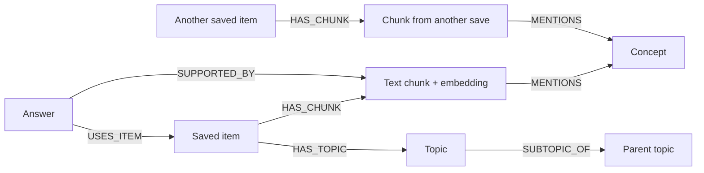
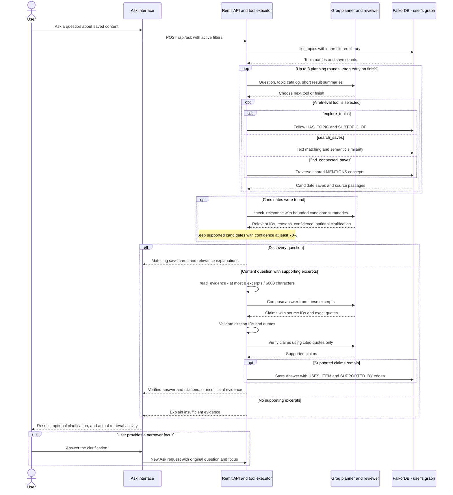
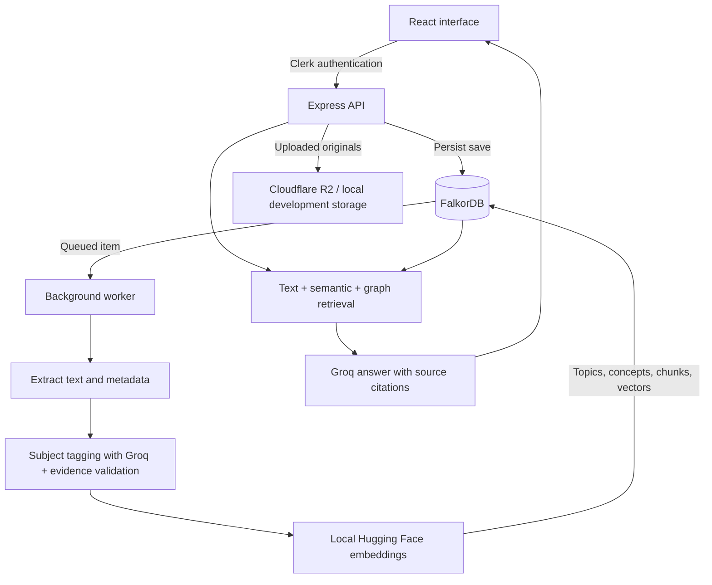

<div align="center">

# Remit

### Save it. Find it again.

Your links, PDFs, images, and notes — connected by topic.


[What it does](#what-it-does) · [Why FalkorDB](#why-falkordb) · [Run locally](#run-locally)

</div>

## One library for everything you want to revisit

A useful reel disappears into Instagram saves. A paper sits in your downloads. A bookmarked article gets buried in another tab.

Remit brings those saves together. Add a link, upload a PDF or image, or write a note. Remit extracts the available text, assigns topics, and connects related material in your personal knowledge graph. Find it later by topic, search by meaning, or ask a question grounded in your saved sources.

## A look at Remit

<details open>
<summary><strong>The landing page</strong></summary>
<br />
<p align="center">
  
</p>
</details>

<details open>
<summary><strong>Library and search page</strong></summary>
<br />
<p align="center">
  
</p>
</details>

## What it does

- **Save in one place.** Add links and notes through the chat interface, or upload PDFs and images.
- **Organize by subject.** Related saves belong together regardless of their original platform. Automatic tags focus on the content's main subject.
- **Find by words or meaning.** Search combines text matching, semantic similarity, and connections through shared concepts.
- **Ask your library.** Get answers with citations to supporting saved passages, so you can return to the source.
- **Explore a broad goal.** Ask whether you saved interview-prep material. Remit explores existing topics, follows shared concepts, shows matching saves, and can ask which role you mean. Expand **How I found this** to inspect actual retrieval calls.
- **Keep your organization.** Explicit preferences and deliberate topic edits are retained during processing.
- **Keep a personal library.** Clerk authenticates requests, and each user has a separate FalkorDB graph. Original uploads are served through authorized file access.

### Different sources. The same interest.

| What you save | Where it belongs |
| --- | --- |
| A Pinterest rangoli pin + an Instagram rangoli reel | **Rangoli** |
| An HLD interview reel + a system design article + a related paper | **System design** |
| A Java exception-handling PDF + your study notes | **Java / Exception Handling** |

These examples illustrate topic grouping when the extracted text supports the subject. You do not need to remember which platform you saved it on.

## Why FalkorDB

**FalkorDB is Remit's primary database and retrieval engine.** It stores saves, topics, text chunks, concepts, embeddings, processing state, preferences, and answer evidence.

The connections are part of how retrieval works:

1. **Topics connect formats.** A PDF and a reel can point to the same topic. Topic hierarchies let retrieval include subtopics.
2. **Concepts connect sources.** Retrieval can follow shared concepts from an initially relevant save to passages in other saves.
3. **Text and vectors support discovery.** FalkorDB full-text search and cosine similarity over locally generated embeddings help retrieve relevant passages.
4. **Answers retain their evidence.** Answer nodes link back to the items used and the chunks supporting the response.



For example, two saved sources mentioning the same concept can be discovered through their graph connections even when they came from different platforms. The resulting answer retains links to its supporting passages.

See the implementation in [`server/graph.ts`](server/graph.ts) and [`server/retrieval.ts`](server/retrieval.ts).

### Bounded, tool-driven Ask

The Ask planner can select `explore_topics`, `search_saves`, or `find_connected_saves` after inspecting the available topics and previous results. It runs at most three planning rounds. Tools execute parameterized queries within the authenticated user's graph and preserve active library filters; the model cannot execute arbitrary Cypher.



The server executes the planner's selected operation; Groq does not connect directly to FalkorDB. Graph traversal produces candidates, while the relevance check decides which candidates are useful for the question. **How I found this** displays the operations that actually ran, rather than a fixed list of simulated steps.

Discovery questions return saved-item cards with a short relevance explanation. A separate check filters candidates before displaying them: sharing a concept such as “machine learning” does not, by itself, make an AI-video save relevant to interview preparation. A follow-up narrows the original request, and **How I found this** shows the retrieval operations that actually ran.

Both relevance decisions and automatic topic proposals require **model confidence of at least 70%** plus source support. This is an acceptance threshold, not a measured accuracy guarantee. There are no fixed subject lists or local keyword-to-topic fallbacks. Existing saved tags are not automatically rewritten by this change. If relevance checking fails, candidates are withheld; unsuccessful tagging uses bounded retries rather than invented labels.

Groq receives bounded inputs at each stage:

| Stage | Maximum supplied context |
| --- | --- |
| Retrieval planning | 80 topic names/counts and eight short result titles; up to three planning rounds |
| Relevance checking | 12 candidates with titles, up to four topic labels each, and 240 characters each of description or, for content questions, a supporting excerpt |
| Answer generation | Eight excerpts, at most 750 characters each and 6,000 source characters total |
| Claim verification | Only proposed claims and cited quotes, capped at 8,000 serialized characters |

These are character and item limits, not token counts. Full documents, raw extraction payloads, and embedding vectors are not included in Ask prompts. Discovery does not invoke the cited-answer generation stage.

## From a save to an answer



Saves are persisted before extraction starts. The background worker processes them, with bounded automatic retries for recoverable failures. If extraction cannot complete, the original save remains in the library.

### Supported content

| Source | How Remit reads it |
| --- | --- |
| Instagram, Pinterest, X | Apify Actors extract available captions, descriptions, and post metadata |
| YouTube | YouTube Data API for title and description, with a public-page metadata fallback |
| Articles and public web pages | Readability, with Jina Reader fallback for supported failures or thin content |
| PDFs | PDF.js text extraction; OCR for scanned pages |
| Images | Tesseract OCR for visible text |
| Notes | Direct text ingestion |

Embeddings run locally through Hugging Face Transformers. Groq handles text classification and answers. Uploaded originals support private Cloudflare R2 storage, with an explicit local-storage option for development.

Current scope is text and metadata: no audio processing, video transcription, or visual scene understanding. Private posts, paywalls, and provider restrictions can limit extraction; captions are not treated as full video content.

## Run locally

**Prerequisites:** Node.js 24, npm, and Docker Desktop with Linux containers.

```sh
npm install
```

Copy [`.env.example`](.env.example) to `.env` and add your provider keys. Use Clerk keys from the same application, configure Groq and Apify, and choose R2 or local development storage. The environment template includes the remaining options.

```sh
docker compose up -d --wait
npm run build:server
npm run models:prepare
npm run dev:all
```

Open **[http://127.0.0.1:5173](http://127.0.0.1:5173)**.

| Service | Local address |
| --- | --- |
| Frontend | `http://127.0.0.1:5173` |
| API health | `http://127.0.0.1:5174/api/health` |
| FalkorDB | `redis://127.0.0.1:6379` |
| FalkorDB browser | `http://127.0.0.1:3000` |

The launcher starts the frontend, API, and worker. Model preparation downloads the local embedding model and OCR language data. After backend edits, rebuild the server and restart the launcher.

For provider configuration, Apify Actor inputs, API routes, and Docker persistence, see the **[setup guide](docs/SETUP.md)**.

## Verification

```sh
# Type checking, unit/HTTP tests, and frontend production build
npm run check

# Integration tests against the configured FalkorDB
npm run test:integration
```

Integration coverage includes user isolation, duplicate saves, processing leases, evidence persistence, topic hierarchy, merge/undo, and ownership checks. Integration tests create temporary graphs and clean them up afterward.

Optional live checks use synthetic content in temporary graphs and make billable Groq requests. Compile the server first and configure FalkorDB and Groq:

```sh
# Broad discovery: relevant interview saves, with unrelated subjects excluded
node scripts/smoke-ask.mjs

# Classification, local embeddings, retrieval, and a source-cited answer
node scripts/smoke-pipeline.mjs
```

These scripts do not read personal libraries and delete their temporary graphs afterward. Model-dependent smoke results are not an accuracy benchmark.

## Project structure

```text
src/                  React interface, components, and client API
server/               Express API, background worker, and extraction pipeline
  graph.ts            FalkorDB persistence and graph operations
  retrieval.ts        Search, graph expansion, and answer evidence
  ask-agent.ts        Bounded tool selection and candidate relevance checks
  ask-context.ts      Excerpt selection and source-text budgets
  ai.ts               Groq text inference
  embeddings.ts       Local text embeddings
  tests/              Backend and integration tests
scripts/              Development launcher and verification tools
docs/                 Setup guide and application screenshots
compose.yaml          Local FalkorDB service and persistent volume
```
